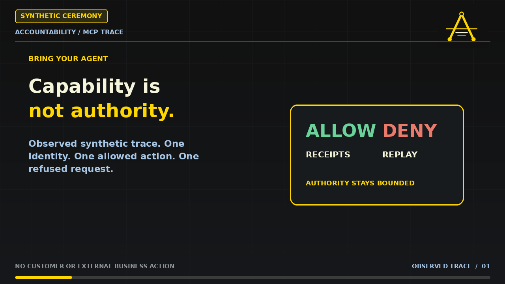

# Bring Your Agent — observed synthetic accountability trace

> **Agents can consume capabilities. They cannot buy authority.**

This proof is an editorial motion-graphics reconstruction of the sealed synthetic ceremony `RST-BYA-DEMO-CEREMONY-20261014T191401Z`. It is not a second live run or a shipping-product UI recording.

[Watch the 2:30 demonstration](./bring-your-agent-synthetic-demo.mp4) · [captions](./bring-your-agent-synthetic-demo.srt) · [sanitized event capture](./SANITIZED_EVENT_CAPTURE.md)

## What was observed

1. A synthetic agent identified itself with the bounded scopes `action.propose` and `drill.read`.
2. `action.propose` returned `ALLOW`, produced receipt `rcp_18693ca347f5443c`, and was billed once.
3. The exact retry returned the same receipt without a second charge.
4. The same identity requested `evidence.export_source`, which was outside its credential scope.
5. Atlas returned `DENY / 403` and produced receipt `rcp_3f390e4ecdb25668`; the denied capability did not execute.
6. Replay returned `FORENSIC_RECONSTRUCTION`. It showed the decision-time scopes and later named an admitted entitlement change without rewriting the historical decision.
7. Revocation refused the next call. Teardown left zero live credentials and entitlements while retaining two receipts.

The ceremony passed 25 of 25 recorded checks. The mastered MP4 SHA-256 is `c7a4475c8dcfd858c7a03d2e782f20c83865ce9841ee77b08a3f74566ddacb75`.

## Boundary

This is a synthetic Accountability/MCP trace. No customer or external participant was admitted, no external business action occurred, and no H.I.F. recomputation or Vantage runtime is claimed. Replay is forensic reconstruction—not model or action re-execution. A receipt records a decision; it is not a grant, a compliance certificate, or a certificate of truth.

## Bring your agent

Read the [Founding Access boundary](../../FOUNDING_ACCESS.md) and bring one agent, one consequential workflow, or one evidence problem. Do not send credentials, tokens, personal records, customer books, restricted information, or production data.

Prefer a self-guided starting point? The [1V Agent Accountability Quickstart](https://reliantscale.com/products/agent-accountability-quickstart?utm_source=github&utm_medium=repository&utm_campaign=bring-your-agent-proof-20261014) is a separate $36 educational workbook. It does not include Atlas access, an assessment, certification, audit, compliance conclusion, or consulting.

