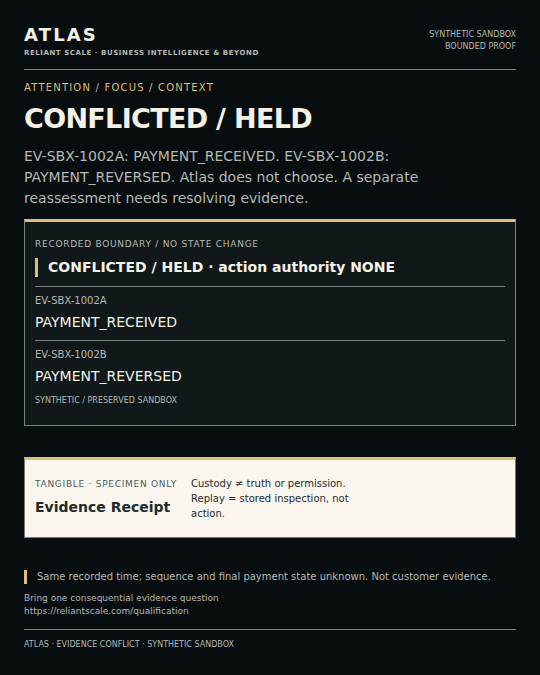

# Evidence conflict



Two admitted synthetic records describe the same invoice at the same recorded time:

```text
PAYMENT_RECEIVED
PAYMENT_REVERSED
```

Atlas reports:

```text
SUPPORT STATE        CONFLICTED
DISCERNMENT          HELD
WINNER SELECTED      NO
EXECUTION AUTHORITY  NONE
```

The system preserves both origins and identifies what additional evidence could support a separate reassessment. It does not infer sequence, choose a preferred source, or authorize an action.

This is a governed synthetic sandbox result. It is not customer evidence, a compliance assessment, or a claim about any external business.

- [Bring one consequential evidence question](https://reliantscale.com/qualification)
- [Request controlled Agent Founding Access](../../FOUNDING_ACCESS.md)
- [Inspect the Atlas interface](../../openapi.yaml)
